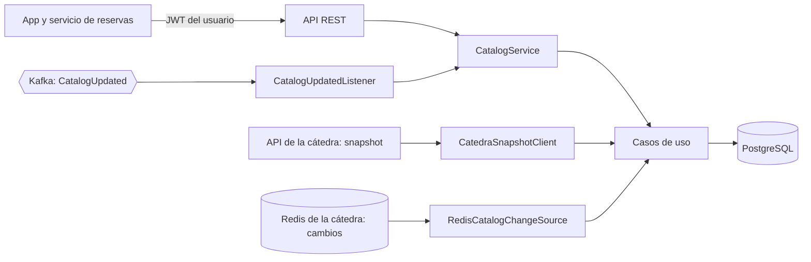

<!-- calidad:inicio -->
            

**Calidad (heurístico, 7 dimensiones):** índice **77/100** · build **OK** · aprobar **sí (8/11)** · destacar **no**
Detalle completo en [`docs/EVALUACION.md`](docs/EVALUACION.md).
<!-- calidad:fin -->

# turnos-servicio-catalogo

[](https://sonarcloud.io/summary/new_code?id=Prog2-IanOlmedo_turnos-servicio-catalogo) [](https://sonarcloud.io/summary/new_code?id=Prog2-IanOlmedo_turnos-servicio-catalogo)

Servicio de catálogo del sistema distribuido de turnos (Programación II, Universidad de Mendoza). Mantiene una copia local del catálogo que publica la cátedra (categorías, profesionales y agendas semanales) y la expone a la app y al servicio de reservas. Caso de estudio académico con datos ficticios.

## Arquitectura

Arquitectura hexagonal por slice vertical (`catalog`). El dominio no depende de Spring ni de la infraestructura.

| Capa | Paquete | Contenido |
|---|---|---|
| Dominio | `domain/model` | `Professional`, `ProfessionalCategory`, `WeeklySchedule`, `ProfessionalFilter`, versiones del catálogo (`CatalogVersionWindow`, `CatalogChange`) |
| Puertos de entrada | `domain/ports/in` | Una interfaz por caso de uso (consultar, buscar, sincronizar, ponerse al día) |
| Puertos de salida | `domain/ports/out` | Repositorios, `CatalogSnapshotProvider` (snapshot) y `CatalogChangeSource` (cambios) |
| Aplicación | `application/usecases`, `application/service` | Implementación de los casos de uso y la fachada `CatalogService` |
| Infraestructura | `infrastructure/*` | `web` (API REST), `persistence` (JPA), `client` (API de la cátedra), `redis`, `messaging` (Kafka), `scheduling`, `startup`, `security` |



## API

Todos los endpoints de `/api` piden `Authorization: Bearer <JWT>`. El token lo emite el servicio de reservas (`POST /api/authenticate`); el catálogo solo lo valida. `GET /actuator/health` es público.

| Método y ruta | Qué devuelve |
|---|---|
| `GET /api/categories` | Categorías de profesionales |
| `GET /api/professionals` | Profesionales habilitados. Filtros opcionales y combinables: `categoryId` y `name` (busca en nombre y apellido, sin importar mayúsculas) |
| `GET /api/professionals/{id}` | Un profesional. 404 si no existe o está deshabilitado |
| `GET /api/professionals/{id}/schedules` | Agenda semanal: día, franja, duración del turno y los horarios (`slots`) ya calculados |

Ejemplos: `/api/professionals?categoryId=101`, `/api/professionals?name=riv`.

Sin token, o con un token inválido o vencido, la respuesta es 401.

## Sincronización con la cátedra

La versión del catálogo aplicada se guarda en `catalog_sync_state`. Hay tres disparadores, y los tres hacen lo mismo:

1. Al arrancar.
2. Con cada evento `CatalogUpdated` de Kafka.
3. Cada 5 minutos, como red de seguridad si se pierde un evento.

En cada pasada se compara la versión local con la ventana que publica la cátedra en Redis (`catedra:sync:metadata`, de la versión más vieja disponible a la actual):

| Situación | Acción |
|---|---|
| La versión local es la actual | Nada (`UP_TO_DATE`) |
| La versión local está dentro de la ventana | Se aplican los cambios de a uno (`catedra:sync:changes:{versión}`), leyendo las entidades de los hashes de Redis. Cada versión va en su propia transacción (`INCREMENTAL`) |
| No hay versión local, quedó fuera de la ventana, falta un cambio o hay un hueco | Se reconstruye todo con el snapshot (`GET /api/catalog/snapshot`) (`SNAPSHOT`) |

**Idempotencia:** una versión menor o igual a la local se ignora, y una versión que no sea la siguiente se rechaza y lleva al snapshot. Un evento repetido o una pasada periódica sin novedades no cambian nada. La sincronización corre de a una por vez.

## Seguridad

- Valida JWT HS512 con la clave compartida `JWT_SECRET` (Base64, mínimo 64 bytes), la misma que usa reservas. Con una clave más corta el servicio no arranca. Los roles salen del claim `auth`.
- Los secretos (contraseña de la base, JWT técnico de la cátedra, credenciales de Redis y `JWT_SECRET`) salen solo del entorno o del `.env`, que está en `.gitignore`. En el repositorio solo hay placeholders (`.env.example`).
- El health no chequea el Redis de la cátedra, porque su ACL no permite `INFO`.

## Modelo de datos

PostgreSQL con migraciones Flyway (`src/main/resources/db`).

| Tabla | Contenido |
|---|---|
| `professional_category` | Categorías de profesionales |
| `professional` | Profesionales (`category_id`, nombre, apellido, `enabled`) |
| `weekly_schedule` | Franjas semanales por profesional (`day_of_week`, `start_time`, `end_time`, `slot_duration_minutes`, `enabled`) |
| `catalog_sync_state` | Versión del catálogo aplicada (`catalog_version`) y cuándo se aplicó |

Los ids son los que publica la cátedra, así un cambio incremental se aplica sobre la misma fila.

## Configuración

```bash
cp .env.example .env
```

Completar `.env` con valores reales. No se sube al repositorio.

| Variable | Para qué |
|---|---|
| `CATALOGO_DB_NAME`, `CATALOGO_DB_USER`, `CATALOGO_DB_PASSWORD`, `CATALOGO_DB_PORT` | Base PostgreSQL propia |
| `CATEDRA_API_URL`, `CATEDRA_JWT` | API de la cátedra (snapshot) y su JWT técnico |
| `REDIS_HOST`, `REDIS_PORT`, `REDIS_USERNAME`, `REDIS_PASSWORD` | Redis de la cátedra (cambios incrementales) |
| `KAFKA_BOOTSTRAP_SERVERS`, `KAFKA_CONSUMER_GROUP_ID`, `KAFKA_CATALOG_TOPIC` | Eventos `CatalogUpdated` |
| `JWT_SECRET` | Clave de los JWT de los usuarios, igual a la de reservas |
| `CATALOGO_APP_PORT` (opcional) | Puerto de la API en el host. Por defecto 8081 |

## Ejecución

```bash
docker compose up -d --build
```

- La API queda en el puerto 8081 del host (`CATALOGO_APP_PORT`).
- PostgreSQL solo escucha en `127.0.0.1` (`CATALOGO_DB_PORT`).
- El `.env` no se copia a la imagen: compose pasa los valores como variables de entorno.
- Para integrarse con la cátedra hace falta estar conectado a su red (ZeroTier).

## Pruebas

```bash
./mvnw verify
```

Requiere Docker: las pruebas levantan PostgreSQL y Redis con Testcontainers. En las pruebas se apagan la sincronización al arrancar, el chequeo periódico y el listener de Kafka, así no dependen de la cátedra. El CI corre el mismo comando y publica el análisis en SonarCloud.

## Relación con reservas

El servicio de reservas usa `GET /api/professionals/{id}/schedules`, reenviando el token del usuario, para calcular la disponibilidad de un profesional en una fecha.
