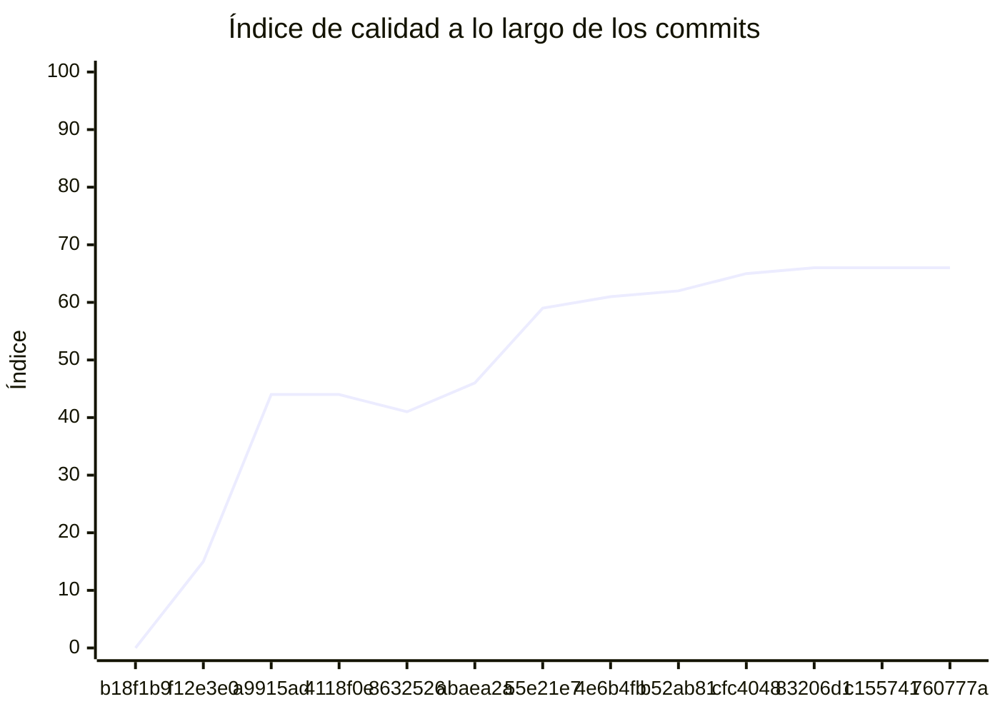

<!-- evaluacion:inicio -->
# Evaluación — Prog2-IanOlmedo/turnos-servicio-catalogo

> Documento **generado automáticamente** por la cátedra de Programación II (UM): RepoSense + análisis de calidad de **7 dimensiones**. **No editar a mano**: se regenera en cada evaluación.
> Rama evaluada: `main`. Análisis **heurístico** (regex + métricas) + build: es una criba para orientar la revisión, **no una nota**. La **documentación** del repositorio no se evalúa.
> Generado: 2026-11-12.

## 1. Veredicto

| Aspecto | Resultado |
|---|---|
| Índice de calidad | **77/100** |
| Tipo de repositorio | `backend` |
| Build (`mvnw verify` / `gradlew check`) | OK |
| Código (LOC) | 2,739 |
| Archivos de código | 98 |
| Clases | 99 |
| Código dentro de clases (%POO) | 66% |
| Funciones fuera de clases | 0 |
| Duplicación (puerta) | 0.0% |
| Duplicación lógica | 0.0% |
| Duplicación de boilerplate | 16.8% |
| Cobertura | 95% |
| Tope duro aplicado a D1 | `POO_BAJO` → D1 ≤ 60 |

> Este informe **describe** lo que el análisis midió con los criterios ya establecidos de la materia. No es una nota.

## 2. Semáforo de aprobación

Criterios de la cátedra (`CRITERIOS-CALIDAD.md`): **Aprobar** se juega con el perfil `estandar`; **destacar**, con el `exigente` (meta de excelencia).

| Semáforo | Resultado |
|---|---|
| Aprobar (`estandar`) | **cumple** — 8/11 |
| Destacar (`exigente`) | **no cumple** — 6/11 |

**Para destacar, falta cumplir:** SOLID; POO

## 3. Autoría (RepoSense)

| Autor | Commits | Código (LOC) | Tests (LOC) | Docs (LOC) | Días activos | % del código |
|---|---:|---:|---:|---:|---:|---:|
| IanOlmedo | 41 | 1,775 | 1,554 | 44 | 13 | 100% |

> _El LOC de autoría lo calcula RepoSense sobre el historial y puede diferir del LOC de código del análisis (que mira el estado de `main`)._

## 4. Dimensiones evaluadas

Cada dimensión indica **qué mide**, **por qué importa** y **tu resultado**. Cuando el puntaje queda por debajo de la referencia, se agregan preguntas para **investigar la causa** (no hay recetas).

| Dimensión | Peso | Puntaje |
|:--|--:|--:|
| **D1** Diseño OO, SOLID y patrones (20%) | 20% | 7 |
| **D2** Arquitectura hexagonal — backend (15%) | 15% | 100 |
| **D3** Frontend KMP: MVVM y buenas prácticas (10%) | 10% | N/A |
| **D4** Integración y contrato (10%) | 10% | 80 |
| **D5** Seguridad y robustez (10%) | 10% | 100 |
| **D6** Pruebas y cobertura (20%) | 20% | 100 |
| **D7** Proceso y entrega (15%) | 15% | 100 |

### D1. Diseño OO, SOLID y patrones (20%)

- **Qué mide:** Métricas orientadas a objetos (clases, métodos, campos, cohesión, acoplamiento, herencia) y proxies de SOLID, más patrones de diseño.
- **Por qué importa:** El eje de la materia es el buen uso de la POO y su arquitectura: un diseño con clases claras y poco acopladas es más fácil de entender, probar y cambiar.
- **Tu resultado:** **7/100**
- **Para investigar la causa:**
    - ¿Se pensó el modelo de clases antes de codificar o se agrupó después?
    - ¿Qué clases concentran muchas responsabilidades a la vez?
    - ¿Los colaboradores llegan como parámetros o se crean por dentro?

### D2. Arquitectura hexagonal — backend (15%)

- **Qué mide:** Separación en capas (dominio, puertos de entrada/salida, adaptadores) y dirección de las dependencias del backend.
- **Por qué importa:** Aislar el dominio de la infraestructura permite cambiar la base de datos, el framework o el transporte sin tocar las reglas de negocio.
- **Tu resultado:** **100/100**

### D4. Integración y contrato (10%)

- **Qué mide:** Cumplimiento del contrato de integración de la cátedra (formato de errores, paginación, autenticación, endpoints esperados).
- **Por qué importa:** Los servicios deben poder integrarse entre sí y con la app sin sorpresas; el contrato es lo que hacen cumplir las pruebas de integración.
- **Tu resultado:** **80/100**

### D5. Seguridad y robustez (10%)

- **Qué mide:** Credenciales embebidas, consultas SQL por concatenación, y presencia de config de entorno; aislamiento de secretos.
- **Por qué importa:** Un secreto en el repositorio o una consulta construida por concatenación son riesgos concretos, no hipotéticos.
- **Tu resultado:** **100/100**

### D6. Pruebas y cobertura (20%)

- **Qué mide:** Cantidad y resultado de pruebas y cobertura de línea (JaCoCo/Kover, Surefire/Failsafe) cuando hay build.
- **Por qué importa:** Las pruebas son la red de seguridad para refactorizar e integrar; la cobertura acota las zonas sin verificar.
- **Tu resultado:** **100/100**

### D7. Proceso y entrega (15%)

- **Qué mide:** Artefactos verificables de proceso/entrega: `compose`, `.env.example`, CI (`.github/workflows/`), `CODEOWNERS` y wrapper de build (`mvnw`/`gradlew`). **No** puntúa documentación.
- **Por qué importa:** Un proyecto que compila, se levanta y se valida solo es más fácil de revisar y de integrar en equipo.
- **Tu resultado:** **100/100**

## 5. Señales detectadas

El análisis encontró las siguientes señales (archivo, sin número de línea a propósito):

**SRP/responsabilidad** (18)
- clase 'RedisCatalogChangeSource' grande (LOC=52, métodos=5, campos=8) — `src/main/java/com/turnos/catalogo/catalog/infrastructure/redis/RedisCatalogChangeSource.java`
- clase 'CatalogSyncStateEntity' sin métodos (4 campos): solo datos — `src/main/java/com/turnos/catalogo/catalog/infrastructure/persistence/entity/CatalogSyncStateEntity.java`
- clase 'ProfessionalCategoryEntity' sin métodos (6 campos): solo datos — `src/main/java/com/turnos/catalogo/catalog/infrastructure/persistence/entity/ProfessionalCategoryEntity.java`
- clase 'WeeklyScheduleEntity' grande (LOC=13, métodos=0, campos=9) — `src/main/java/com/turnos/catalogo/catalog/infrastructure/persistence/entity/WeeklyScheduleEntity.java`
- clase 'WeeklyScheduleEntity' sin métodos (9 campos): solo datos — `src/main/java/com/turnos/catalogo/catalog/infrastructure/persistence/entity/WeeklyScheduleEntity.java`
- clase 'ProfessionalEntity' sin métodos (7 campos): solo datos — `src/main/java/com/turnos/catalogo/catalog/infrastructure/persistence/entity/ProfessionalEntity.java`
- clase 'ScheduleResponse' sin métodos (7 campos): solo datos — `src/main/java/com/turnos/catalogo/catalog/infrastructure/web/dto/ScheduleResponse.java`
- clase 'ProfessionalResponse' sin métodos (4 campos): solo datos — `src/main/java/com/turnos/catalogo/catalog/infrastructure/web/dto/ProfessionalResponse.java`
- clase 'CategoryResponse' sin métodos (3 campos): solo datos — `src/main/java/com/turnos/catalogo/catalog/infrastructure/web/dto/CategoryResponse.java`
- clase 'CatalogService' con baja cohesión (10%) — `src/main/java/com/turnos/catalogo/catalog/application/service/CatalogService.java`
- método 'CatchUpCatalogUseCaseImpl.catchUp' con complejidad 6 — `src/main/java/com/turnos/catalogo/catalog/application/usecases/CatchUpCatalogUseCaseImpl.java`
- clase 'WeeklySchedule' grande (LOC=28, métodos=2, campos=9) — `src/main/java/com/turnos/catalogo/catalog/domain/model/WeeklySchedule.java`
- clase 'ProfessionalCategory' sin métodos (6 campos): solo datos — `src/main/java/com/turnos/catalogo/catalog/domain/model/ProfessionalCategory.java`
- clase 'Professional' sin métodos (7 campos): solo datos — `src/main/java/com/turnos/catalogo/catalog/domain/model/Professional.java`
- método 'CatedraSnapshotMapperTest.pasaElSnapshotCompletoAlDominio' de 39 líneas — `src/test/java/com/turnos/catalogo/catalog/infrastructure/client/mapper/CatedraSnapshotMapperTest.java`
- clase 'ApplyCatalogSnapshotUseCaseImplTest' grande (LOC=45, métodos=4, campos=8) — `src/test/java/com/turnos/catalogo/catalog/application/usecases/ApplyCatalogSnapshotUseCaseImplTest.java`
- clase 'ApplyCatalogChangeUseCaseImplTest' grande (LOC=50, métodos=4, campos=8) — `src/test/java/com/turnos/catalogo/catalog/application/usecases/ApplyCatalogChangeUseCaseImplTest.java`
- clase 'CatalogSnapshotTest' con baja cohesión (20%) — `src/test/java/com/turnos/catalogo/catalog/domain/model/CatalogSnapshotTest.java`

**DIP/concretos** (27)
- clase 'RedisCatalogChangeSource' muy acoplada (CBO=17) — `src/main/java/com/turnos/catalogo/catalog/infrastructure/redis/RedisCatalogChangeSource.java`
- clase 'RedisCatalogChangeSource' instancia 5 concretos (CBO=17) — `src/main/java/com/turnos/catalogo/catalog/infrastructure/redis/RedisCatalogChangeSource.java`
- clase 'CatalogUpdatedListener' muy acoplada (CBO=10) — `src/main/java/com/turnos/catalogo/catalog/infrastructure/messaging/CatalogUpdatedListener.java`
- clase 'CatedraSnapshotClient' muy acoplada (CBO=11) — `src/main/java/com/turnos/catalogo/catalog/infrastructure/client/CatedraSnapshotClient.java`
- clase 'CatedraSnapshotMapper' muy acoplada (CBO=9) — `src/main/java/com/turnos/catalogo/catalog/infrastructure/client/mapper/CatedraSnapshotMapper.java`
- clase 'CatalogService' muy acoplada (CBO=14) — `src/main/java/com/turnos/catalogo/catalog/application/service/CatalogService.java`
- clase 'CatchUpCatalogUseCaseImpl' muy acoplada (CBO=13) — `src/main/java/com/turnos/catalogo/catalog/application/usecases/CatchUpCatalogUseCaseImpl.java`
- clase 'ApplyCatalogChangeUseCaseImpl' muy acoplada (CBO=10) — `src/main/java/com/turnos/catalogo/catalog/application/usecases/ApplyCatalogChangeUseCaseImpl.java`
- clase 'ApplyCatalogSnapshotUseCaseImpl' muy acoplada (CBO=9) — `src/main/java/com/turnos/catalogo/catalog/application/usecases/ApplyCatalogSnapshotUseCaseImpl.java`
- clase 'WeeklySchedule' muy acoplada (CBO=8) — `src/main/java/com/turnos/catalogo/catalog/domain/model/WeeklySchedule.java`
- clase 'GlobalExceptionHandler' muy acoplada (CBO=14) — `src/main/java/com/turnos/catalogo/shared/web/GlobalExceptionHandler.java`
- clase 'CatalogPersistenceTests' muy acoplada (CBO=21) — `src/test/java/com/turnos/catalogo/CatalogPersistenceTests.java`
- clase 'CatalogSnapshotIntegrationTests' muy acoplada (CBO=15) — `src/test/java/com/turnos/catalogo/CatalogSnapshotIntegrationTests.java`
- clase 'RedisCatalogChangeSourceTest' muy acoplada (CBO=12) — `src/test/java/com/turnos/catalogo/catalog/infrastructure/redis/RedisCatalogChangeSourceTest.java`
- clase 'RedisCatalogChangeSourceTest' instancia 5 concretos (CBO=12) — `src/test/java/com/turnos/catalogo/catalog/infrastructure/redis/RedisCatalogChangeSourceTest.java`
- clase 'CatalogUpdatedListenerTest' muy acoplada (CBO=9) — `src/test/java/com/turnos/catalogo/catalog/infrastructure/messaging/CatalogUpdatedListenerTest.java`
- clase 'CatedraSnapshotClientTest' muy acoplada (CBO=25) — `src/test/java/com/turnos/catalogo/catalog/infrastructure/client/CatedraSnapshotClientTest.java`
- clase 'CatedraSnapshotMapperTest' muy acoplada (CBO=18) — `src/test/java/com/turnos/catalogo/catalog/infrastructure/client/mapper/CatedraSnapshotMapperTest.java`
- clase 'CatedraSnapshotMapperTest' instancia 6 concretos (CBO=18) — `src/test/java/com/turnos/catalogo/catalog/infrastructure/client/mapper/CatedraSnapshotMapperTest.java`
- clase 'CatalogControllerTest' muy acoplada (CBO=23) — `src/test/java/com/turnos/catalogo/catalog/infrastructure/web/controller/CatalogControllerTest.java`
- clase 'CatalogControllerTest' instancia 6 concretos (CBO=23) — `src/test/java/com/turnos/catalogo/catalog/infrastructure/web/controller/CatalogControllerTest.java`
- clase 'CatalogServiceTest' muy acoplada (CBO=13) — `src/test/java/com/turnos/catalogo/catalog/application/service/CatalogServiceTest.java`
- clase 'ApplyCatalogSnapshotUseCaseImplTest' muy acoplada (CBO=11) — `src/test/java/com/turnos/catalogo/catalog/application/usecases/ApplyCatalogSnapshotUseCaseImplTest.java`
- clase 'ApplyCatalogChangeUseCaseImplTest' muy acoplada (CBO=11) — `src/test/java/com/turnos/catalogo/catalog/application/usecases/ApplyCatalogChangeUseCaseImplTest.java`
- clase 'ApplyCatalogChangeUseCaseImplTest' instancia 4 concretos (CBO=11) — `src/test/java/com/turnos/catalogo/catalog/application/usecases/ApplyCatalogChangeUseCaseImplTest.java`
- clase 'CatchUpCatalogUseCaseImplTest' muy acoplada (CBO=14) — `src/test/java/com/turnos/catalogo/catalog/application/usecases/CatchUpCatalogUseCaseImplTest.java`
- clase 'CatchUpCatalogUseCaseImplTest' instancia 4 concretos (CBO=14) — `src/test/java/com/turnos/catalogo/catalog/application/usecases/CatchUpCatalogUseCaseImplTest.java`

**OCP/type-switch** (1)
- clase 'GlobalExceptionHandler' con 1 type-checks — `src/main/java/com/turnos/catalogo/shared/web/GlobalExceptionHandler.java`

## 6. Evolución por commit

Métricas calculadas sobre el estado de `main` en **cada commit** (13 commits con trabajo), del primero al último. La calidad usa el perfil `exigente`; el aporte de código lo mide RepoSense. El índice puede **bajar** al crecer el proyecto: se acumulan señales.

| # | Fecha | Commit | Autor | LOC | Índice | %POO | Duplic. | Sueltas |
|---|---|---|---|---:|---:|---:|---:|---:|
| 1 | 2026-09-05 | `b18f1b9` | IanOlmedo | 0 | 0 | 0% | 0.0% | 0 |
| 2 | 2026-09-10 | `f12e3e0` | Ing. Daniel Quinteros | 0 | 15 | 0% | 0.0% | 0 |
| 3 | 2026-10-13 | `a9915ad` | IanOlmedo | 41 | 44 | 54% | 0.0% | 0 |
| 4 | 2026-10-16 | `4118f0e` | IanOlmedo | 41 | 44 | 54% | 0.0% | 0 |
| 5 | 2026-10-16 | `8632526` | IanOlmedo | 472 | 41 | 63% | 0.0% | 0 |
| 6 | 2026-10-16 | `abaea2a` | IanOlmedo | 472 | 46 | 63% | 0.0% | 0 |
| 7 | 2026-10-22 | `55e21e7` | IanOlmedo | 1,074 | 59 | 63% | 0.0% | 0 |
| 8 | 2026-10-24 | `4e6b4fb` | IanOlmedo | 1,181 | 61 | 64% | 0.0% | 0 |
| 9 | 2026-10-30 | `b52ab81` | IanOlmedo | 1,505 | 62 | 64% | 0.0% | 0 |
| 10 | 2026-11-02 | `cfc4048` | IanOlmedo | 1,876 | 65 | 66% | 0.0% | 0 |
| 11 | 2026-11-02 | `83206d1` | IanOlmedo | 2,030 | 66 | 66% | 0.0% | 0 |
| 12 | 2026-11-02 | `c155741` | IanOlmedo | 2,030 | 66 | 66% | 0.0% | 0 |
| 13 | 2026-11-11 | `760777a` | IanOlmedo | 2,739 | 66 | 66% | 0.0% | 0 |

---
_Informe generado por la cátedra. Las dimensiones y umbrales corresponden a `calidad.py` (perfil `exigente`); el semáforo, a `CRITERIOS-CALIDAD.md`. La documentación del repositorio no se evalúa. Ante dudas, revisá el archivo señalado._
<!-- evaluacion:fin -->
