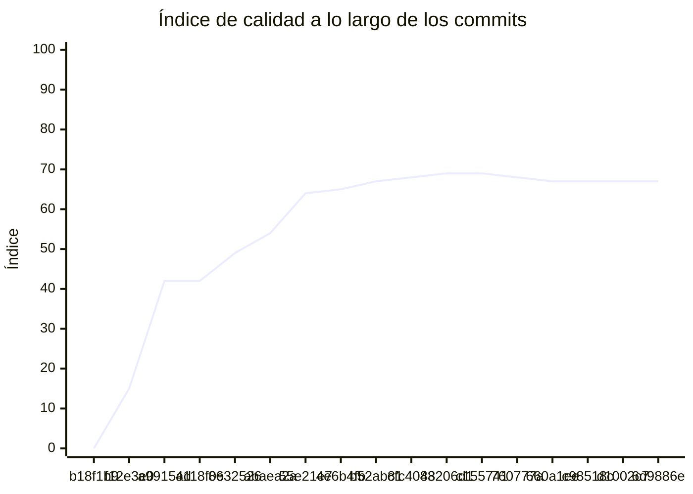

<!-- evaluacion:inicio -->
# Evaluación — Prog2-IanOlmedo/turnos-servicio-catalogo

> Documento **generado automáticamente** por la cátedra de Programación II (UM): RepoSense + análisis de calidad de **7 dimensiones**. **No editar a mano**: se regenera en cada evaluación.
> Rama evaluada: `main`. Análisis **heurístico** (regex + métricas) + build: es una criba para orientar la revisión, **no una nota**. La **documentación** del repositorio no se evalúa.
> Generado: 2026-11-20.

## 1. Veredicto

| Aspecto | Resultado |
|---|---|
| Índice de calidad | **78/100** |
| Tipo de repositorio | `backend` |
| Build (`mvnw verify` / `gradlew check`) | OK |
| Código (LOC) | 3,084 |
| Archivos de código | 108 |
| Clases | 109 |
| Código dentro de clases (%POO) | 63% |
| Funciones fuera de clases | 0 |
| Duplicación (puerta) | 0.0% |
| Duplicación lógica | 0.0% |
| Duplicación de boilerplate | 15.1% |
| Cobertura | 96% |
| Tope duro aplicado a D1 | `POO_BAJO` → D1 ≤ 60 |

> Este informe **describe** lo que el análisis midió con los criterios ya establecidos de la materia. No es una nota.

## 2. Semáforo de aprobación

Criterios de la cátedra (`CRITERIOS-CALIDAD.md`): **Aprobar** se juega con el perfil `estandar`; **destacar**, con el `exigente` (meta de excelencia).

| Semáforo | Resultado |
|---|---|
| Aprobar (`estandar`) | **cumple** — 8/11 |
| Destacar (`exigente`) | **no cumple** — 6/11 |

**Para destacar, falta cumplir:** SOLID; POO

## 3. Autoría (RepoSense)

| Autor | Commits | Código (LOC) | Tests (LOC) | Docs (LOC) | Días activos | % del código |
|---|---:|---:|---:|---:|---:|---:|
| IanOlmedo | 46 | 1,937 | 1,825 | 123 | 17 | 100% |

> _El LOC de autoría lo calcula RepoSense sobre el historial y puede diferir del LOC de código del análisis (que mira el estado de `main`)._

## 4. Dimensiones evaluadas

Cada dimensión indica **qué mide**, **por qué importa** y **tu resultado**. Cuando el puntaje queda por debajo de la referencia, se agregan preguntas para **investigar la causa** (no hay recetas).

| Dimensión | Peso | Puntaje |
|:--|--:|--:|
| **D1** Diseño OO, SOLID y patrones (20%) | 20% | 13 |
| **D2** Arquitectura hexagonal — backend (15%) | 15% | 100 |
| **D3** Frontend KMP: MVVM y buenas prácticas (10%) | 10% | N/A |
| **D4** Integración y contrato (10%) | 10% | 80 |
| **D5** Seguridad y robustez (10%) | 10% | 100 |
| **D6** Pruebas y cobertura (20%) | 20% | 100 |
| **D7** Proceso y entrega (15%) | 15% | 100 |

### D1. Diseño OO, SOLID y patrones (20%)

- **Qué mide:** Métricas orientadas a objetos (clases, métodos, campos, cohesión, acoplamiento, herencia) y proxies de SOLID, más patrones de diseño.
- **Por qué importa:** El eje de la materia es el buen uso de la POO y su arquitectura: un diseño con clases claras y poco acopladas es más fácil de entender, probar y cambiar.
- **Tu resultado:** **13/100**
- **Para investigar la causa:**
    - ¿Se pensó el modelo de clases antes de codificar o se agrupó después?
    - ¿Qué clases concentran muchas responsabilidades a la vez?
    - ¿Los colaboradores llegan como parámetros o se crean por dentro?

### D2. Arquitectura hexagonal — backend (15%)

- **Qué mide:** Separación en capas (dominio, puertos de entrada/salida, adaptadores) y dirección de las dependencias del backend.
- **Por qué importa:** Aislar el dominio de la infraestructura permite cambiar la base de datos, el framework o el transporte sin tocar las reglas de negocio.
- **Tu resultado:** **100/100**

### D4. Integración y contrato (10%)

- **Qué mide:** Cumplimiento del contrato de integración de la cátedra (formato de errores, paginación, autenticación, endpoints esperados).
- **Por qué importa:** Los servicios deben poder integrarse entre sí y con la app sin sorpresas; el contrato es lo que hacen cumplir las pruebas de integración.
- **Tu resultado:** **80/100**

### D5. Seguridad y robustez (10%)

- **Qué mide:** Credenciales embebidas, consultas SQL por concatenación, y presencia de config de entorno; aislamiento de secretos.
- **Por qué importa:** Un secreto en el repositorio o una consulta construida por concatenación son riesgos concretos, no hipotéticos.
- **Tu resultado:** **100/100**

### D6. Pruebas y cobertura (20%)

- **Qué mide:** Cantidad y resultado de pruebas y cobertura de línea (JaCoCo/Kover, Surefire/Failsafe) cuando hay build.
- **Por qué importa:** Las pruebas son la red de seguridad para refactorizar e integrar; la cobertura acota las zonas sin verificar.
- **Tu resultado:** **100/100**

### D7. Proceso y entrega (15%)

- **Qué mide:** Artefactos verificables de proceso/entrega: `compose`, `.env.example`, CI (`.github/workflows/`), `CODEOWNERS` y wrapper de build (`mvnw`/`gradlew`). **No** puntúa documentación.
- **Por qué importa:** Un proyecto que compila, se levanta y se valida solo es más fácil de revisar y de integrar en equipo.
- **Tu resultado:** **100/100**

## 5. Señales detectadas

El análisis encontró las siguientes señales, con el archivo y la línea donde se originan cuando están disponibles:

**Archivos con más señales**

| Archivo | Señales |
|---|---:|
| `src/main/java/com/turnos/catalogo/catalog/infrastructure/redis/RedisCatalogChangeSource.java` | 3 |
| `src/main/java/com/turnos/catalogo/shared/web/GlobalExceptionHandler.java` | 3 |
| `src/main/java/com/turnos/catalogo/catalog/infrastructure/security/JwtConfig.java` | 2 |
| `src/main/java/com/turnos/catalogo/catalog/application/service/CatalogService.java` | 2 |
| `src/main/java/com/turnos/catalogo/catalog/application/usecases/CatchUpCatalogUseCaseImpl.java` | 2 |
| `src/main/java/com/turnos/catalogo/catalog/infrastructure/security/SecurityConfig.java` | 1 |
| `src/main/java/com/turnos/catalogo/catalog/infrastructure/messaging/CatalogUpdatedListener.java` | 1 |
| `src/main/java/com/turnos/catalogo/catalog/infrastructure/client/CatedraSnapshotClient.java` | 1 |
| `src/main/java/com/turnos/catalogo/catalog/infrastructure/client/mapper/CatedraSnapshotMapper.java` | 1 |
| `src/main/java/com/turnos/catalogo/catalog/infrastructure/client/dto/CatedraScheduleDto.java` | 1 |

**SRP/responsabilidad** (8)
- clase 'CatalogService' con baja cohesión (0%) — `src/main/java/com/turnos/catalogo/catalog/application/service/CatalogService.java:23`
- método 'CatchUpCatalogUseCaseImpl.catchUp' con complejidad 6 — `src/main/java/com/turnos/catalogo/catalog/application/usecases/CatchUpCatalogUseCaseImpl.java:32`
- método 'CatedraCategoryDto.CatedraCategoryDto' con 6 parámetros — `src/main/java/com/turnos/catalogo/catalog/infrastructure/client/dto/CatedraCategoryDto.java:8`
- método 'CatedraProfessionalDto.CatedraProfessionalDto' con 7 parámetros — `src/main/java/com/turnos/catalogo/catalog/infrastructure/client/dto/CatedraProfessionalDto.java:8`
- método 'CatedraScheduleDto.CatedraScheduleDto' con 9 parámetros — `src/main/java/com/turnos/catalogo/catalog/infrastructure/client/dto/CatedraScheduleDto.java:11`
- método 'CatedraSnapshotDto.CatedraSnapshotDto' con 5 parámetros — `src/main/java/com/turnos/catalogo/catalog/infrastructure/client/dto/CatedraSnapshotDto.java:10`
- clase 'RedisCatalogChangeSource' grande (LOC=52, métodos=4, campos=8) — `src/main/java/com/turnos/catalogo/catalog/infrastructure/redis/RedisCatalogChangeSource.java:28`
- método 'GlobalExceptionHandler.handleExceptionInternal' con 5 parámetros — `src/main/java/com/turnos/catalogo/shared/web/GlobalExceptionHandler.java:32`

**DIP/concretos** (15)
- clase 'CatalogService' muy acoplada (CBO=16) — `src/main/java/com/turnos/catalogo/catalog/application/service/CatalogService.java:23`
- clase 'ApplyCatalogChangeUseCaseImpl' muy acoplada (CBO=10) — `src/main/java/com/turnos/catalogo/catalog/application/usecases/ApplyCatalogChangeUseCaseImpl.java:16`
- clase 'ApplyCatalogSnapshotUseCaseImpl' muy acoplada (CBO=9) — `src/main/java/com/turnos/catalogo/catalog/application/usecases/ApplyCatalogSnapshotUseCaseImpl.java:16`
- clase 'CatchUpCatalogUseCaseImpl' muy acoplada (CBO=13) — `src/main/java/com/turnos/catalogo/catalog/application/usecases/CatchUpCatalogUseCaseImpl.java:24`
- clase 'WeeklySchedule' muy acoplada (CBO=8) — `src/main/java/com/turnos/catalogo/catalog/domain/model/WeeklySchedule.java:17`
- clase 'CatedraSnapshotClient' muy acoplada (CBO=11) — `src/main/java/com/turnos/catalogo/catalog/infrastructure/client/CatedraSnapshotClient.java:18`
- clase 'CatedraSnapshotMapper' muy acoplada (CBO=9) — `src/main/java/com/turnos/catalogo/catalog/infrastructure/client/mapper/CatedraSnapshotMapper.java:19`
- clase 'CatalogUpdatedListener' muy acoplada (CBO=10) — `src/main/java/com/turnos/catalogo/catalog/infrastructure/messaging/CatalogUpdatedListener.java:19`
- clase 'RedisCatalogChangeSource' muy acoplada (CBO=17) — `src/main/java/com/turnos/catalogo/catalog/infrastructure/redis/RedisCatalogChangeSource.java:28`
- clase 'RedisCatalogChangeSource' instancia 5 concretos (CBO=17) — `src/main/java/com/turnos/catalogo/catalog/infrastructure/redis/RedisCatalogChangeSource.java:28`
- clase 'JwtConfig' muy acoplada (CBO=14) — `src/main/java/com/turnos/catalogo/catalog/infrastructure/security/JwtConfig.java:21`
- clase 'JwtConfig' instancia 4 concretos (CBO=14) — `src/main/java/com/turnos/catalogo/catalog/infrastructure/security/JwtConfig.java:21`
- clase 'SecurityConfig' muy acoplada (CBO=9) — `src/main/java/com/turnos/catalogo/catalog/infrastructure/security/SecurityConfig.java:15`
- clase 'CatalogController' muy acoplada (CBO=9) — `src/main/java/com/turnos/catalogo/catalog/infrastructure/web/controller/CatalogController.java:22`
- clase 'GlobalExceptionHandler' muy acoplada (CBO=14) — `src/main/java/com/turnos/catalogo/shared/web/GlobalExceptionHandler.java:18`

**OCP/type-switch** (1)
- clase 'GlobalExceptionHandler' con 1 type-checks — `src/main/java/com/turnos/catalogo/shared/web/GlobalExceptionHandler.java:18`

## 6. Evolución por commit

Métricas calculadas sobre el estado de `main` en **cada commit** (17 commits con trabajo), del primero al último. La calidad usa el perfil `exigente`; el aporte de código lo mide RepoSense. El índice puede **bajar** al crecer el proyecto: se acumulan señales.

| # | Fecha | Commit | Autor | LOC | Índice | %POO | Duplic. | Sueltas |
|---|---|---|---|---:|---:|---:|---:|---:|
| 1 | 2026-09-05 | `b18f1b9` | IanOlmedo | 0 | 0 | 0% | 0.0% | 0 |
| 2 | 2026-09-10 | `f12e3e0` | Ing. Daniel Quinteros | 0 | 15 | 0% | 0.0% | 0 |
| 3 | 2026-10-13 | `a9915ad` | IanOlmedo | 41 | 42 | 56% | 0.0% | 0 |
| 4 | 2026-10-16 | `4118f0e` | IanOlmedo | 41 | 42 | 56% | 0.0% | 0 |
| 5 | 2026-10-16 | `8632526` | IanOlmedo | 472 | 49 | 62% | 0.0% | 0 |
| 6 | 2026-10-16 | `abaea2a` | IanOlmedo | 472 | 54 | 62% | 0.0% | 0 |
| 7 | 2026-10-22 | `55e21e7` | IanOlmedo | 1,074 | 64 | 61% | 0.0% | 0 |
| 8 | 2026-10-24 | `4e6b4fb` | IanOlmedo | 1,181 | 65 | 61% | 0.0% | 0 |
| 9 | 2026-10-30 | `b52ab81` | IanOlmedo | 1,505 | 67 | 61% | 0.0% | 0 |
| 10 | 2026-11-02 | `cfc4048` | IanOlmedo | 1,876 | 68 | 62% | 0.0% | 0 |
| 11 | 2026-11-02 | `83206d1` | IanOlmedo | 2,030 | 69 | 63% | 0.0% | 0 |
| 12 | 2026-11-02 | `c155741` | IanOlmedo | 2,030 | 69 | 63% | 0.0% | 0 |
| 13 | 2026-11-11 | `760777a` | IanOlmedo | 2,739 | 68 | 63% | 0.0% | 0 |
| 14 | 2026-11-12 | `660a1ee` | IanOlmedo | 2,917 | 67 | 63% | 0.0% | 0 |
| 15 | 2026-11-12 | `c98518c` | IanOlmedo | 3,084 | 67 | 63% | 0.0% | 0 |
| 16 | 2026-11-17 | `d1002c7` | IanOlmedo | 3,084 | 67 | 63% | 0.0% | 0 |
| 17 | 2026-11-18 | `6d9886e` | IanOlmedo | 3,084 | 67 | 63% | 0.0% | 0 |

---
_Informe generado por la cátedra. Las dimensiones y umbrales corresponden a `calidad.py` (perfil `exigente`); el semáforo, a `CRITERIOS-CALIDAD.md`. La documentación del repositorio no se evalúa. Ante dudas, revisá el archivo señalado._
<!-- evaluacion:fin -->
